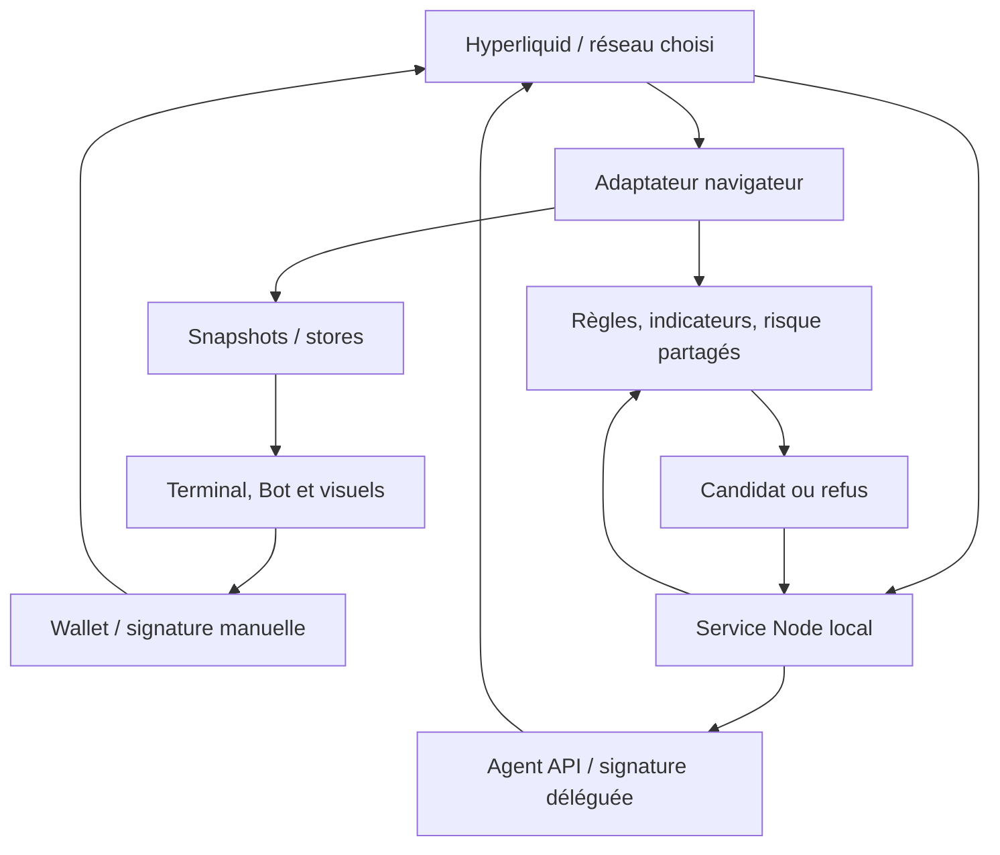

# Architecture d’OMEGA

## Frontières du système

OMEGA contient un frontend statique et deux services locaux distincts. Le moteur d’exécution actuel est Node ; Python reste une voie de compatibilité pour recherche, simulation et MCP. Ni le site statique ni un Worker de replay ne constituent un service exchange permanent.

Le graphe montre les responsabilités, pas une séquence d’envoi automatique déclenchée par le navigateur. Le runner relit ses propres données et autorisations avant une entrée. Le frontend de commande parle au runner uniquement sur l’origine locale prévue.

## Carte des sources

| Zone | Entrées importantes | Responsabilité |
|---|---|---|
| Démarrage | [main.ts](../frontend/main.ts), [index.html](../frontend/index.html) | Adaptateur runtime, contrôleur, modules différés et contrats HTML |
| UI historique active | [legacy/ui.js](../frontend/legacy/ui.js) | Navigation principale, rafraîchissement, tableaux, formulaires paper |
| Adaptateurs | [browser-engine.js](../frontend/legacy/browser-engine.js), [local-adapter.js](../frontend/legacy/local-adapter.js) | Données publiques/paper web ou appels au serveur Python |
| Types et règles | [types.ts](../frontend/core/types.ts), [daily.ts](../frontend/core/daily.ts), [execution.ts](../frontend/core/execution.ts) | Snapshot, évaluation Daily et profondeur visible |
| Indicateurs / plans | [indicators.js](../frontend/core/indicators.js), [plan.ts](../frontend/core/plan.ts), [testnet-plan.ts](../frontend/core/testnet-plan.ts) | Calculs clôturés, plan paper, plan exchange sur les deux réseaux |
| Simulation automatique | [controller.ts](../frontend/core/controller.ts) | Armement paper navigateur, nouvelles clôtures, Web Locks |
| Stores | [market-store.ts](../frontend/shared/market-store.ts), [runner-store.ts](../frontend/shared/runner-store.ts) | Dernier snapshot observé ; état confirmé du service |
| Connexion wallet | [wallet-connection.ts](../frontend/wallet-connection.ts), [wallet-store.ts](../frontend/shared/wallet-store.ts), [wallet-provider.ts](../frontend/shared/wallet-provider.ts) | Parcours visible, session de lecture/signature partagée, sélection MetaMask EIP-6963 ; aucun armement à la connexion |
| Présentation | [workspace.ts](../frontend/workspace.ts), [bot-dashboard.ts](../frontend/bot-dashboard.ts), [bot-view.ts](../frontend/core/bot-view.ts) | Diagnostic, journal, sous-onglets Bot et lectures des horizons |
| Exchange manuel | [exchange.ts](../frontend/exchange.ts) | Connexion wallet, plan, signatures, lecture et rapprochement |
| Commande du service | [runner-ui.ts](../frontend/runner-ui.ts), [network.ts](../frontend/network.ts) | Session locale, approbation agent, armement, changement de réseau |
| Graphique | [market-chart.ts](../frontend/charts/market-chart.ts), [data-buffer.ts](../frontend/charts/data-buffer.ts) | Lightweight Charts, données/EMA incrémentales, corrections historiques |
| Visualisation | [depth-model.ts](../frontend/visuals/depth-model.ts), [depth-scene.ts](../frontend/visuals/depth-scene.ts) | Modèle L2 pur et projection Canvas 3D |
| Recherche | [research.ts](../frontend/research.ts), [research.worker.ts](../frontend/research.worker.ts), [replay.ts](../frontend/core/replay.ts) | Acquisition, calcul en Worker, résultats locaux et CSV |
| Service Node | [server.ts](../runner/server.ts) | HTTP, session, clés, nonces, persistance, verrou de processus |
| Automatisation | [engine.ts](../runner/engine.ts), [policy.ts](../runner/policy.ts) | État du pilote, revalidation, plan IOC, gestion de position |
| Risque | [lib.rs](../rust-core/src/lib.rs), [runtime-risk.ts](../runner/runtime-risk.ts) | Noyau Rust/WASM et chargement Node |
| Styles | [interface.css](../frontend/interface.css), [layout.css](../frontend/layout.css), [obsidian.css](../frontend/obsidian.css) | Point d’import, base en couche CSS et thème/priorités visuelles |

`frontend/legacy/` n’est pas une archive : plusieurs fichiers y sont exécutés. `testnet-plan.ts` conserve un nom historique mais `exchangePlan` gère explicitement testnet **et** mainnet. Son wrapper `testnetPlan` reste limité au testnet.

## Cycle d’un snapshot navigateur

1. L’adaptateur reçoit carnet/transactions par WebSocket et historiques/métadonnées par REST. Il garde fraîcheur, erreurs et cache.
2. `legacy/ui.js` demande `/api/state` à l’adaptateur, pilote la simulation et publie `axiom-state`.
3. `workspace.ts` transmet le snapshot à `market-store`, puis construit les diagnostics et, si visible, le journal.
4. Les consommateurs différés reçoivent immédiatement le dernier snapshot lorsqu’ils s’abonnent. Ils n’ouvrent pas chacun un flux Hyperliquid.
5. `runner-store` est indépendant : son contenu vient des réponses du service local, pas d’un score navigateur. Le store wallet publie uniquement la session de signature/lecture établie par `exchange.ts` ; il ne transforme ni une adresse consultée ni une lecture du compte en autorisation d’agent.

`window.BrowserAtelier`, `window.PaperPilot`, `window.TradingChart` et les hooks `ExchangeSnapshot`/`OmegaRunnerGate` sont des ponts actifs typés dans [globals.d.ts](../frontend/globals.d.ts). Leur suppression demande une migration de leurs consommateurs.

## Compatibilité Python et outils racine

| Fichier | Rôle conservé |
|---|---|
| [bot.py](../bot.py) | Client REST Hyperliquid public et passerelle de lecture ; ce nom historique ne désigne pas le pilote automatique Node |
| [engine.py](../engine.py) | Collecte/état et simulation du moteur Python |
| [analysis.py](../analysis.py) | Indicateurs et descriptions Python, avec TA-Lib |
| [multiframe.py](../multiframe.py) | Candidats et confluence exploratoires historiques |
| [research.py](../research.py) | Backtests exploratoires Python, distincts du replay Daily web |
| [app.py](../app.py) | HTTP local, assets web et API paper du port 8765 |
| [agent_bridge.py](../agent_bridge.py) | MCP stdio paper-only vers le serveur Python |
| [start.ps1](../start.ps1) | Lanceur Windows du serveur Python |
| [sync_docs.py](../sync_docs.py) | Téléchargement facultatif de documentation officielle vers un dossier ignoré |

Le dossier `docs/archive/` archive des textes ; il ne déplace pas ces modules de compatibilité ni leurs imports.

## Chargement et affichage

- `main.ts` initialise l’adaptateur et les contrôles essentiels ; graphique/profondeur, Recherche et tableau de bord Bot arrivent à la visite de leur espace.
- Le module de signature manuelle arrive à l’ouverture des outils manuels. L’autorisation d’un agent importe son propre SDK au clic.
- Le proxy du graphique conserve le dernier rendu demandé avant l’arrivée de son module. `ChartBuffer` détecte les corrections de préfixe et recalcule les EMA à partir de la première modification.
- Les lignes du carnet sont réutilisées. Les clés de rendu limitent les reconstructions des horizons, événements et positions.
- La profondeur 3D est une projection Canvas, pas un rendu Three.js/WebGL. Les orbites du Bot utilisent CSS en perspective. Les animations sont locales et ne prennent aucune décision.

## Chemin d’une entrée Node

`arm` vérifie consentement mainnet, paramètres, agent, compte, quota et absence d’exposition ETH. Le service mémorise la clôture déjà observée et attend une nouvelle clôture.

À chaque tick pertinent : snapshot propre au service → `evaluateDaily` → plan exchange → réglage du levier → nouveau snapshot et nouvelle évaluation → réservation durable quota/cloid → envoi du lot IOC + SL/TP. Une réponse incertaine conserve un envoi à réconcilier ; elle ne provoque pas une relance d’entrée.

La surveillance de la position attribuée au bot est distincte de l’armement des entrées. Pour les transitions, paramètres HTTP et fichiers personnels, voir [OPERATIONS.md](OPERATIONS.md).

## Unités et identités

| Champ / valeur | Unité ou identité |
|---|---|
| `Snapshot.time`, `context.updatedAt`, `candleStatus.fetchedAt` | Secondes Unix |
| Candle `t`, `T`, indicateur `lastClosedTime`, carnet `time` | Millisecondes Unix |
| Événements/heartbeat du runner, nonce et expiration d’ordre | Millisecondes Unix |
| `Position.openedAt` du contrat Snapshot | Secondes Unix ; vérifier les historiques anciens mixtes |
| Prix, équité, marge, P&L | USDC ; prix par ETH |
| Taille, cumul, quantité | ETH |
| Frais/spread/slippage | Basis points : 1 bps = 0,01 % |
| Compte lu | Adresse du compte principal concerné, pas adresse de l’agent |
| Signataire délégué | Adresse de l’agent propre au réseau/processus |
| Jour du mandat | UTC, indépendant du fuseau d’affichage utilisateur |

`runtime: 'local'` n’est pas un synonyme d’exécution réelle : il apparaît aussi dans le chemin Python paper et dans les snapshots internes Node. Identifier le module et le mode avant toute interprétation.

## État et artefacts

| Chemin | Rôle | Source canonique ? |
|---|---|---|
| `frontend/`, `runner/`, `rust-core/` | Code à modifier | Oui |
| `dist/` | Build web consommé par hébergement/serveurs locaux | Non |
| `runner-dist/` | Build Node | Non |
| `.omega-runtime/` | Clés d’agents, nonces, quotas, journal et verrou | Non, personnel/secret |
| `config.json`, `data/` | Configuration et simulation/token Python | Non, personnels |
| `config.example.json`, `mcp-config.example.json` | Exemples sans autorisation personnelle | Oui |
| `.openai/hosting.json` | Identité et configuration du site existant | Oui, préserver l’identité |

## Choix de structure

1. Conserver le frontend DOM existant, sans migration de framework incidente.
2. Mutualiser les règles pures plutôt que développer trois stratégies divergentes.
3. Séparer état observé et autorité d’exécution : les visuels ne signent pas.
4. Conserver les points d’entrée Python à la racine pour les imports, scripts Windows et clients MCP existants.
5. Archiver les anciennes spécifications ; ne pas leur donner des noms de documentation courante.
6. Garder l’hébergement statique séparé du processus local : publier le site n’arme aucun compte.
