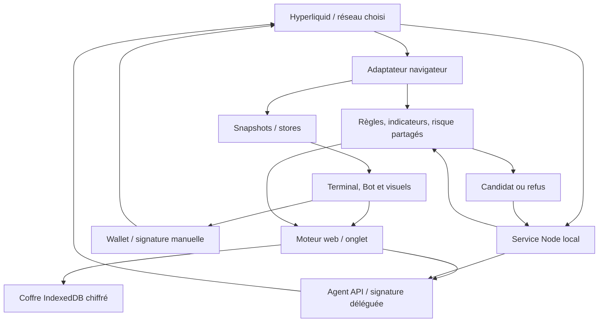

# Architecture d’OMEGA

## Frontières du système

OMEGA contient un frontend statique capable d’exécution web et deux services locaux distincts. Le moteur LiveEngine est partagé entre le navigateur et Node ; Python reste une voie de compatibilité pour recherche, simulation et MCP. Ni le site statique ni un Worker de replay ne constituent un service exchange permanent.

Le graphe montre les responsabilités, pas une séquence d’envoi automatique déclenchée par le navigateur. Le runner relit ses propres données et autorisations avant une entrée. Sur le site publié, les commandes utilisent le moteur web ; sur l’origine Node prévue, elles utilisent l’API locale. Les deux modes relisent leurs données propres.

## Organisation et dépendances

`frontend/` possède le DOM et les API navigateur ; `runner/` possède les API Node ; `shared/` possède le moteur commun, sans dépendance à ces adaptateurs. Les deux adaptateurs injectent leurs transports, sauvegarde et risque dans LiveEngine. `frontend/shared/` désigne uniquement les stores/utilitaires UI, pas le moteur commun.

Les calculs Daily et réseaux de `frontend/core/` sont purs et importables par shared. Le dossier contient aussi des contrôleurs navigateur : seules les dépendances pures nécessaires au moteur sont autorisées par le contrôle de structure. `vitest.config.ts` découvre les tests dans les trois zones ; la racine Vite reste `frontend/`.

## Carte des sources

| Zone | Entrées importantes | Responsabilité |
|---|---|---|
| Démarrage | [main.ts](../frontend/main.ts), [index.html](../frontend/index.html) | Adaptateur runtime, contrôleur, modules différés et contrats HTML |
| UI historique active | [legacy/ui.js](../frontend/legacy/ui.js) | Navigation principale, rafraîchissement, tableaux, formulaires paper |
| Adaptateurs | [browser-engine.js](../frontend/legacy/browser-engine.js), [local-adapter.js](../frontend/legacy/local-adapter.js) | Données publiques/paper web ou appels au serveur Python |
| Session intraday | [session.js](../frontend/core/session.js) | Quota, objectif réalisé, pause, pertes consécutives ; partagé navigateur/replay/runner |
| Types et règles | [types.ts](../frontend/core/types.ts), [daily.ts](../frontend/core/daily.ts), [execution.ts](../frontend/core/execution.ts) | Snapshot, évaluation Daily et profondeur visible |
| Indicateurs / plans | [indicators.js](../frontend/core/indicators.js), [plan.ts](../frontend/core/plan.ts), [testnet-plan.ts](../frontend/core/testnet-plan.ts) | Calculs clôturés, plan paper, plan exchange sur les deux réseaux |
| Simulation automatique | [controller.ts](../frontend/core/controller.ts) | Armement paper navigateur, nouvelles clôtures, Web Locks |
| Stores | [market-store.ts](../frontend/shared/market-store.ts), [runner-store.ts](../frontend/shared/runner-store.ts) | Dernier snapshot observé ; état confirmé du service |
| Réseaux | [networks.js](../frontend/core/networks.js) | Définitions REST/WS immuables, transport signé et refus des incohérences |
| Connexion wallet | [wallet-connection.ts](../frontend/wallet-connection.ts), [wallet-store.ts](../frontend/shared/wallet-store.ts), [wallet-provider.ts](../frontend/shared/wallet-provider.ts), [wallet-memory.ts](../frontend/shared/wallet-memory.ts) | Parcours visible, prochaine étape et dépliage du compte, session de lecture/signature partagée, sélection MetaMask EIP-6963 ; aucun armement à la connexion |
| Présentation | [workspace.ts](../frontend/workspace.ts), [bot-dashboard.ts](../frontend/bot-dashboard.ts), [bot-view.ts](../frontend/core/bot-view.ts) | Diagnostic, journal, sous-onglets Bot et lectures des horizons |
| Exchange manuel | [exchange.ts](../frontend/exchange.ts) | Connexion wallet, plan, signatures, lecture et rapprochement |
| Commande du service | [runner-ui.ts](../frontend/runner-ui.ts), [network.ts](../frontend/network.ts) | Session locale, approbation agent, armement, changement de réseau |
| Graphique | [market-chart.ts](../frontend/charts/market-chart.ts), [data-buffer.ts](../frontend/charts/data-buffer.ts) | Lightweight Charts, données/EMA incrémentales, corrections historiques |
| Visualisation | [depth-model.ts](../frontend/visuals/depth-model.ts), [liquidity.ts](../frontend/visuals/liquidity.ts) | Modèle L2 pur et profondeur cumulée SVG |
| Recherche | [research.ts](../frontend/research.ts), [research.worker.ts](../frontend/research.worker.ts), [replay.ts](../frontend/core/replay.ts) | Acquisition, calcul en Worker, résultats locaux et CSV |
| Persistance | [paper-storage.js](../frontend/core/paper-storage.js), [data-archive.ts](../frontend/core/data-archive.ts), [data-settings.ts](../frontend/data-settings.ts), [persistence.ts](../runner/persistence.ts) | Validation, versions, générations précédentes, export et état du stockage |
| Service Node | [server.ts](../runner/server.ts) | HTTP, session, clés, nonces, persistance, verrou de processus |
| Exécution web | [web/runner.ts](../frontend/web/runner.ts), [web/vault.ts](../frontend/web/vault.ts) | Même LiveEngine, coffre IndexedDB chiffré, lock d’onglet et contrôle au transport |
| Moteur commun | [engine.ts](../shared/engine.ts), [policy.ts](../shared/policy.ts), [ledger.ts](../shared/ledger.ts) | État du pilote, revalidation, plan IOC, gestion de position et validation pure du ledger |
| Risque | [lib.rs](../rust-core/src/lib.rs), [runtime-risk.ts](../runner/runtime-risk.ts) | Noyau Rust/WASM et chargement Node |
| Styles | [interface.css](../frontend/interface.css), [layout.css](../frontend/layout.css), [obsidian.css](../frontend/obsidian.css) | Point d’import, base en couche CSS et thème/priorités visuelles ; tokens.css et polices locales pour toutes les vues |

`frontend/legacy/` n’est pas une archive : plusieurs fichiers y sont exécutés. `testnet-plan.ts` conserve un nom historique mais `exchangePlan` gère explicitement testnet **et** mainnet. Son wrapper `testnetPlan` reste limité au testnet.

## Cycle d’un snapshot navigateur

1. L’adaptateur reçoit carnet/transactions par WebSocket et historiques/métadonnées par REST. Il garde fraîcheur, erreurs et cache.
2. `legacy/ui.js` demande `/api/state` à l’adaptateur, pilote la simulation et publie `axiom-state`.
3. `workspace.ts` transmet le snapshot à `market-store`, puis construit les diagnostics et, si visible, le journal.
4. Les consommateurs différés reçoivent immédiatement le dernier snapshot lorsqu’ils s’abonnent. Ils n’ouvrent pas chacun un flux Hyperliquid.
5. `runner-store` est indépendant : son contenu vient du moteur web ou du service local, pas d’un score descriptif navigateur. Le store wallet publie uniquement la session de signature/lecture établie par `exchange.ts` ; il ne transforme ni une adresse consultée ni une lecture du compte en autorisation d’agent.

`window.BrowserAtelier`, `window.PaperPilot`, `window.TradingChart` et les hooks `ExchangeSnapshot`/`OmegaRunnerGate` sont des ponts actifs typés dans [globals.d.ts](../frontend/globals.d.ts). Leur suppression demande une migration de leurs consommateurs.

## Compatibilité Python et outils racine

| Fichier | Rôle conservé |
|---|---|
| [bot.py](../bot.py) | Client REST Hyperliquid public et passerelle de lecture ; ce nom historique ne désigne pas le pilote automatique Node |
| [engine.py](../engine.py) | Collecte/état et simulation du moteur Python |
| [analysis.py](../analysis.py) | Indicateurs et descriptions Python, avec TA-Lib |
| [multiframe.py](../multiframe.py) | Candidats et confluence exploratoires historiques |
| [research.py](../research.py) | Backtests exploratoires Python, distincts du replay Daily web |
| [app.py](../app.py) | HTTP local, assets web et API paper du port 8765 |
| [agent_bridge.py](../agent_bridge.py) | MCP stdio paper-only vers le serveur Python |
| [start.ps1](../start.ps1) | Lanceur Windows du serveur Python |
| [sync_docs.py](../sync_docs.py) | Téléchargement facultatif de documentation officielle vers un dossier ignoré |

Le dossier `docs/archive/` archive des textes ; il ne déplace pas ces modules de compatibilité ni leurs imports.

## Chargement et affichage

- `main.ts` initialise l’adaptateur et les contrôles essentiels ; graphique/profondeur, Recherche et tableau de bord Bot arrivent à la visite de leur espace.
- Le module de signature manuelle arrive à l’ouverture des outils manuels. L’autorisation d’un agent importe son propre SDK au clic.
- Le proxy du graphique conserve le dernier rendu demandé avant l’arrivée de son module. `ChartBuffer` détecte les corrections de préfixe et recalcule les EMA à partir de la première modification.
- Les lignes du carnet sont réutilisées. Les clés de rendu limitent les reconstructions des horizons, événements et positions.
- La profondeur est une courbe SVG statique mise à jour depuis market-store. Aucun contrôle de caméra ni boucle d’animation. Les douze niveaux de chaque côté sont cumulés séparément et affichés sur une échelle commune.

## Chemin d’une entrée déléguée web/Node

`arm` vérifie consentement mainnet, paramètres, agent, compte, quota et absence d’exposition ETH. Le service mémorise la clôture déjà observée et attend une nouvelle clôture.

À chaque tick pertinent : snapshot propre au moteur → `evaluateDaily` → plan exchange → réglage du levier → nouveau snapshot et nouvelle évaluation → réservation durable quota/cloid → envoi du lot IOC + SL/TP. Une réponse incertaine conserve un envoi à réconcilier ; elle ne provoque pas une relance d’entrée.

La surveillance de la position attribuée au bot est distincte de l’armement des entrées. Son snapshot ne charge ni bougies ni fills quotidiens et ne valide pas le quota d’entrée : une panne de ces données ne doit pas bloquer le contrôle des protections. Le rapprochement borne l’attribution au sens et aux quantités exécutées de l’ordre enregistré ; une exposition agrandie ou inversée reste bloquée. Pour les transitions, paramètres HTTP et fichiers personnels, voir [OPERATIONS.md](OPERATIONS.md).

## Unités et identités

| Champ / valeur | Unité ou identité |
|---|---|
| `Snapshot.time`, `context.updatedAt`, `candleStatus.fetchedAt` | Secondes Unix |
| Candle `t`, `T`, indicateur `lastClosedTime`, carnet `time` | Millisecondes Unix |
| Événements/heartbeat du runner, nonce et expiration d’ordre | Millisecondes Unix |
| `Position.openedAt` du contrat Snapshot | Secondes Unix ; vérifier les historiques anciens mixtes |
| Prix, équité, marge, P&L | USDC ; prix par ETH |
| Taille, cumul, quantité | ETH |
| Frais/spread/slippage | Basis points : 1 bps = 0,01 % |
| Compte lu | Adresse du compte principal concerné, pas adresse de l’agent |
| Signataire délégué | Adresse de l’agent propre au réseau/processus |
| Jour du mandat | UTC, indépendant du fuseau d’affichage utilisateur |

`runtime: 'local'` n’est pas un synonyme d’exécution réelle : il apparaît aussi dans le chemin Python paper et dans les snapshots internes Node. Identifier le module et le mode avant toute interprétation.

## État et artefacts

| Chemin | Rôle | Source canonique ? |
|---|---|---|
| `frontend/`, `shared/`, `runner/`, `rust-core/` | Code à modifier | Oui |
| `dist/` | Build web consommé par hébergement/serveurs locaux | Non |
| `runner-dist/` | Build Node | Non |
| `.omega-runtime/` | Clés d’agents, nonces, quotas, journal et verrou | Non, personnel/secret |
| `config.json`, `data/` | Configuration et simulation/token Python | Non, personnels |
| `config.example.json`, `mcp-config.example.json` | Exemples sans autorisation personnelle | Oui |
| `.openai/hosting.json` | Identité et configuration du site existant | Oui, préserver l’identité |

## Choix de structure

1. Conserver le frontend DOM existant, sans migration de framework incidente.
2. Mutualiser les règles pures plutôt que développer trois stratégies divergentes.
3. Séparer état observé et autorité d’exécution : les visuels ne signent pas.
4. Conserver les points d’entrée Python à la racine pour les imports, scripts Windows et clients MCP existants.
5. Archiver les anciennes spécifications ; ne pas leur donner des noms de documentation courante.
6. Garder l’hébergement statique séparé du processus local : publier le site n’arme aucun compte.

## Réservations intraday

Le ledger conserve `attemptDay`, `attemptCount` et `lastAttemptAt` et `lastExitAt` (secondes). Un ancien ledger sans compteur mais avec une date d’essai conserve une tentative consommée. Le compteur est écrit avec le pending/cloid avant l’envoi. Réconciliation et redémarrage ne le remettent pas à zéro. Le service compare le nombre de fills d’entrée du compte au compteur local et retient leur maximum ; il n’offre pas de quota global transactionnel entre logiciels indépendants.

La matrice des réseaux, schémas de signature et garde-fous de concurrence est décrite dans [NETWORKS.md](NETWORKS.md).

## Bloc de connexion du Bot

`wallet-connection.ts` présente la progression des trois étapes à partir de wallet-store et runner-store. L’action principale reste un bouton déclenché par l’utilisateur : lecture MetaMask, ouverture du guide, autorisation ou démarrage via les commandes existantes. `runner-ui.ts` garde les contrôles effectifs d’autorisation, de consentement et d’armement ; un bouton désactivé ne peut pas être contourné par la navigation. Les états busy sont partagés pour éviter un second clic concurrent. Le compte et les diagnostics techniques utilisent des disclosures natifs ; aucun framework ajouté.

## Reprise de connexion

`wallet-memory.ts` conserve l’adresse publique et la préférence de reconnexion sur l’origine courante. `wallet-connection.ts` peut charger `exchange.ts` pour restaurer passivement le compte primaire via `eth_accounts` ; aucune mutation exchange n’est incluse. `runner-ui.ts` lit et vérifie séparément les deux réseaux, affiche `approvedUntil`, et n’appelle `configure`/`approveAgent` qu’après clic et pour un agent manquant. Les clés sont dans le coffre chiffré en mode web ou les fichiers du service en mode Node. La session HTTP Node est renouvelée une fois après un 401 ; aucune relance automatique n’est ajoutée pour les autres erreurs ou envois incertains.

La politique de conservation, les données exclues des exports et les limites de récupération sont dans [DATA.md](DATA.md). Le drapeau `paper.storageBlocked` bloque la session de simulation quand l’état ne peut pas être validé ou enregistré ; il ne réinitialise pas le compte.

La validation pure des ledgers est extraite dans [shared/ledger.ts](../shared/ledger.ts) pour les deux persistances. Les callbacks de sauvegarde de LiveEngine acceptent une Promise et sont attendus avant transmission. Le protocole du coffre et les limites de cycle de page sont dans [WEB.md](WEB.md).
